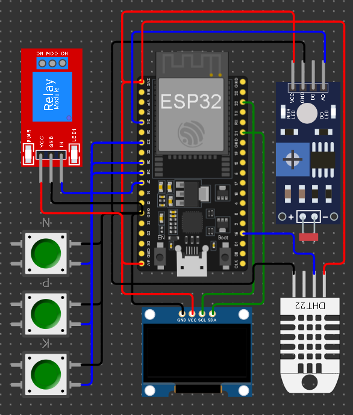
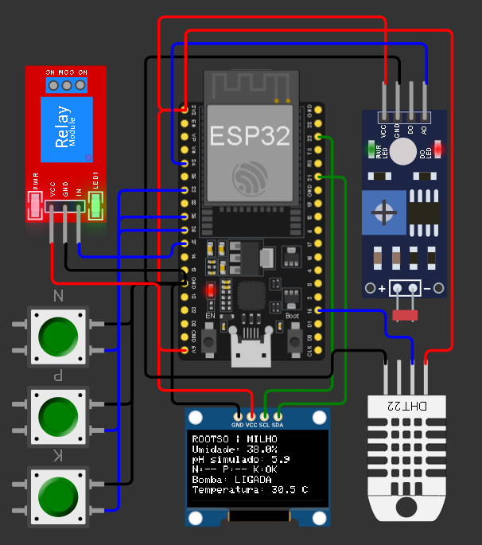

# ROOTSO — Sistema de irrigação inteligente para milho

Protótipo didático de irrigação automatizada desenvolvido com ESP32, Arduino C/C++ e Wokwi como continuação do projeto de agricultura digital **Rootso**. O sistema simula o monitoramento de uma plantação de milho e controla uma bomba representada por um módulo relé, de acordo com a umidade informada pelo DHT22.

> O projeto é uma simulação educacional. O DHT22 mede umidade do ar, o LDR mede intensidade de luz e os botões não medem nutrientes reais. Esses componentes representam sensores agrícolas para fins didáticos.

## Simulação

[Abrir o projeto ROOTSO no Wokwi](https://wokwi.com/projects/477721948578267137)

## Demonstração do circuito e da tela

### Circuito completo



### Tela OLED durante a simulação



## Objetivo

O projeto demonstra uma estação simulada de monitoramento agrícola que:

- lê umidade e temperatura pelo DHT22;
- representa os níveis de nitrogênio, fósforo e potássio com três botões;
- converte a leitura do LDR em uma escala didática de pH;
- exibe as leituras e o estado da irrigação em um OLED SSD1306;
- liga ou desliga o relé conforme os limites de umidade definidos no programa.

## Componentes simulados

| Componente | Função no projeto |
|---|---|
| ESP32 | Lê os componentes, executa a lógica de irrigação e atualiza o display |
| DHT22 | Fornece temperatura e umidade do ar, usada como aproximação didática da umidade do solo |
| OLED SSD1306, 128 × 64, I2C | Exibe os dados e o estado da bomba |
| LDR | Mede intensidade de luz; sua leitura é convertida para uma escala didática de pH de 0 a 14 |
| Botão N | Simula o estado do nitrogênio |
| Botão P | Simula o estado do fósforo |
| Botão K | Simula o estado do potássio |
| Módulo relé azul | Representa o acionamento da bomba de irrigação |

No circuito, os botões pressionados aparecem como `OK` e os botões soltos como `--`. Essa representação binária não corresponde a uma análise química real do solo.

## Ligações do circuito

| Componente | Pino do componente | GPIO ou alimentação do ESP32 |
|---|---|---|
| OLED SSD1306 | SDA | GPIO 21 |
| OLED SSD1306 | SCL | GPIO 22 |
| OLED SSD1306 | VCC | 3V3 |
| OLED SSD1306 | GND | GND |
| DHT22 | DATA | GPIO 15 |
| DHT22 | VCC | 3V3 |
| DHT22 | GND | GND |
| LDR | AO | GPIO 34 |
| LDR | VCC | 3V3 |
| LDR | GND | GND |
| Botão N | sinal | GPIO 32 |
| Botão P | sinal | GPIO 25 |
| Botão K | sinal | GPIO 26 |
| Botões N, P e K | outro terminal | GND |
| Relé | IN | GPIO 27 |
| Relé | VCC | 5V |
| Relé | GND | GND |

Os botões são configurados com `INPUT_PULLUP`. Portanto, no código, o botão solto é lido como `HIGH` e o botão pressionado como `LOW`.

## Lógica de irrigação

A bomba é controlada pela umidade simulada lida pelo DHT22:

| Condição de umidade | Decisão |
|---|---|
| Menor que 40% | Liga a irrigação |
| De 40% até menos de 45% | Mantém o estado anterior |
| Igual ou maior que 45% | Desliga a irrigação |

A diferença entre os limites de ligar e desligar cria uma histerese: ela evita que o relé fique alternando rapidamente quando a leitura está perto de um único limite.

Se a leitura do DHT22 for inválida, o código mantém a bomba desligada por segurança.

Os limites de 40% e 45% foram escolhidos para demonstrar e testar o funcionamento do protótipo. **Não são recomendações agronômicas para o cultivo real de milho.**

Os estados de N, P e K e o valor de pH simulado são apresentados no display e no Monitor Serial, mas **não participam da decisão de ligar ou desligar a bomba** nesta versão.

## Conversão didática do LDR

O valor analógico do LDR é convertido proporcionalmente, usando a faixa de leitura de 0 a 4095, para uma escala didática de 0 a 14:

```text
pH simulado = leitura do LDR × 14 / 4095
```
Essa conversão serve somente para representar uma escala na simulação. Um LDR não mede pH. No projeto, a atividade também propõe alterar o LDR quando os estados dos botões N, P ou K forem modificados, para representar didaticamente uma possível mudança de pH.

Código e arquivos
```text
rootso-hardware/
├── README.md
├── assets/
│   ├── circuit.png
│   └── oled.png
└── wokwi/
    ├── diagram.json
    ├── libraries.txt
    └── sketch.ino
```
wokwi/diagram.json: componentes e conexões do circuito simulado.
wokwi/sketch.ino: código Arduino C/C++ executado pelo ESP32.
wokwi/libraries.txt: bibliotecas utilizadas pelo sketch.
assets/: imagens do circuito e da tela OLED.
Como executar
Acesse o projeto ROOTSO no Wokwi.
Inicie a simulação com o botão Play.
Observe os valores no OLED e no Monitor Serial.
Altere a umidade do DHT22 para testar o acionamento do relé.
Pressione os botões N, P e K individualmente e observe os indicadores.
Ajuste o controle de luz do LDR e observe a leitura analógica e o pH simulado.
Para reproduzir o projeto em outro sketch do Wokwi, use os arquivos diagram.json e sketch.ino da pasta wokwi/ e adicione as bibliotecas indicadas no arquivo libraries.txt.

Bibliotecas
O projeto utiliza:

Adafruit GFX Library
Adafruit SSD1306
DHT sensor library for ESPx
Testes realizados
Durante os testes no Wokwi, foram observados:

leitura variável de umidade e temperatura pelo DHT22;
mudança dos indicadores N, P e K ao pressionar cada botão;
variação da leitura LDR e do pH simulado ao alterar a intensidade de luz;
irrigação ligada com uma leitura de umidade de 26%;
irrigação desligada com uma leitura de umidade de 61,5%;
exibição do estado da irrigação no OLED e no Monitor Serial.
Limitações
O DHT22 mede umidade do ar, não umidade do solo. Nesta atividade, é utilizado como aproximação didática.
O LDR mede intensidade de luz, não pH. A conversão para 0–14 é apenas uma representação didática.
Os botões representam estados binários de N, P e K; não medem concentração de nutrientes.
O módulo relé representa uma bomba na simulação. Não há bomba física controlada por este protótipo.
Os limites de irrigação e as leituras apresentados não devem ser usados como recomendação de manejo agrícola real.
Nesta versão, somente a umidade simulada controla a irrigação; N, P, K e pH são exibidos para monitoramento didático.
Vídeo de demonstração
Adicionar aqui o link do vídeo não listado no YouTube, com duração máxima de cinco minutos:

[Inserir link do vídeo do YouTube]

Continuidade do Rootso
Este protótipo de hardware complementa o projeto Rootso, que trabalha com agricultura digital e inclui as culturas de milho e soja. Nesta etapa, foi escolhida a cultura do milho.
